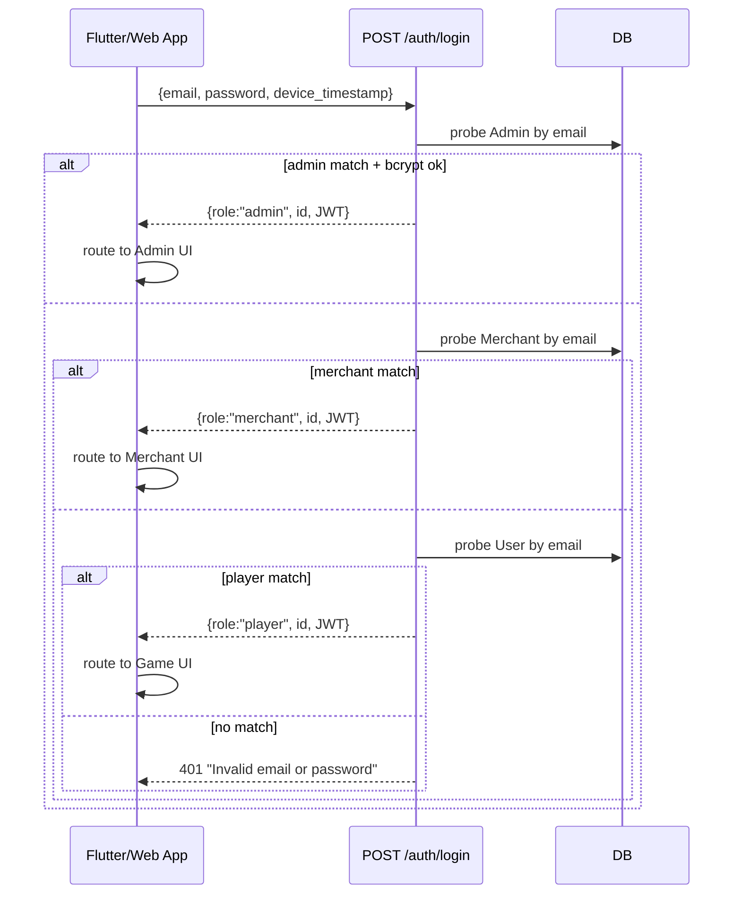
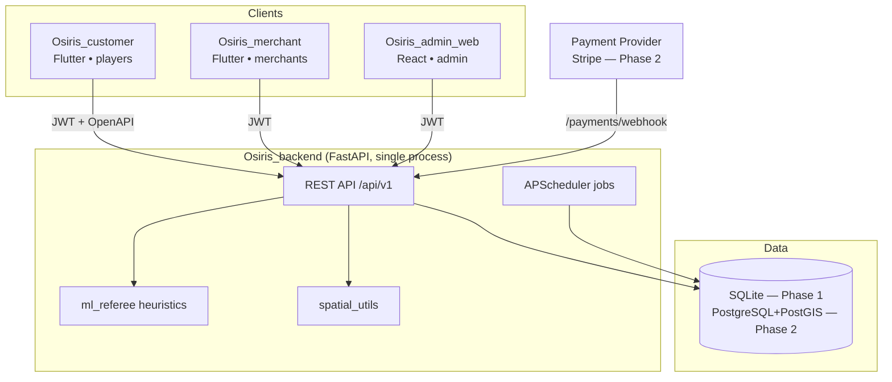

# Osiris — Master Specification

| Field | Value |
| :--- | :--- |
| **Document Type** | Consolidated PRD + TRD + Architecture reference |
| **Version** | 1.0 |
| **Date** | 2026-06-10 |
| **Owner** | Gagandeep Thind |
| **Status** | Phase 1 MVP — backend feature-complete, hardening in progress |
| **Companion docs** | [Imp_and_US.md](Imp_and_US.md) (GDD), [Task.md](../Task.md) (tracker), [User Story.md](User%20Story.md), [Deep_Audit_2026-06.md](Deep_Audit_2026-06.md) |

> **Purpose:** the single source of truth for *what* Osiris is, *why* it exists, *what it must do* (product), *how it is built* (technical), and *how data and control flow through it*. Grounded in the live codebase as of v2.12. Where the code and the vision differ, both are stated.

---

## Table of Contents

1. [What Osiris Is](#1-what-osiris-is)
2. [Product Requirements Document (PRD)](#2-product-requirements-document-prd)
3. [Technical Requirements Document (TRD)](#3-technical-requirements-document-trd)
4. [Data & Logic Flow](#4-data--logic-flow)
5. [System Architecture](#5-system-architecture)
6. [Appendix — Endpoint & Schema Reference](#6-appendix--endpoint--schema-reference)

---

# 1. What Osiris Is

## 1.1 One-liner
**Osiris is a real-world Action-RPG where verified physical effort becomes digital rank, territorial ownership, and rewards.** *"Earn Your Awakening."*

## 1.2 The core idea
Players use their body in the real world — running, walking, push-ups, planks — and an AI "Referee" verifies the effort actually happened (not a phone shaken in a pocket or a GPS spoof). Verified effort converts into:

- **Physical Grade** — a combat rank (D → C → B → A → S → SS → SSS) driven by XP.
- **Territorial Title** — Warden → Lord → High Lord → Sovereign, driven by how much real-world land you've claimed.
- **Mana Crystals** — the in-game currency (virtual in Phase 1; real-money-convertible in Phase 2).

## 1.3 The three loops
1. **Bounties (low stakes):** geofenced daily tasks ("20 push-ups in DeWolf Park") and merchant-sponsored chests ("visit this café, get a coupon"). Keeps players active and feeds the merchant (B2B) economy.
2. **Domain Expansion (medium stakes):** trace a closed GPS polygon by physically walking/running it; the enclosed area becomes your territory. Optionally lock crystals into a **Vault** to protect it.
3. **Sieges (high stakes):** run a polygon that *swallows* an enemy's domain, then beat their "Defense Feat" score to conquer it and win their Vault.

## 1.4 Who uses it (three audiences, three apps)
| Audience | App | Role | What they do |
| :--- | :--- | :--- | :--- |
| **Players** | `Osiris_customer` (Flutter) | `player` | Register, claim land, do bounties, siege, level up |
| **Merchants** | `Osiris_merchant` (Flutter) | `merchant` | Register a business, pay a pilot fee, sponsor chests, redeem coupons |
| **Admin (you)** | `Osiris_admin_web` (React) | `admin` | Audit revenue, manage merchants, oversee the world |

A single backend serves all three; the login response's `role` field decides which app/UI a credential unlocks.

## 1.5 Business model
- **B2C:** Vault wagers (20% War Tax to platform), future Black Market (15% fee), future Tower Pass subscription.
- **B2B:** merchants pay a pilot fee (~$50) to place a "Legendary Chest" that drives foot traffic; players unlock a coupon by physically visiting.

## 1.6 Pilot scope (Phase 1)
The **Bedford Pilot** — ~50 local testers in DeWolf Park / Sunnyside Mall, Bedford NS. Virtual currency only. Safety-first: park "stay-in-the-zone" quests, no live-road speed challenges.

---

# 2. Product Requirements Document (PRD)

## 2.1 Vision & goals
Deliver a persistent virtual world overlaid on the real world, where every km² can be claimed, defended, or conquered through verified physical performance — and where local businesses can buy real foot traffic.

**Phase 1 success criteria:** 50 pilot testers can register, complete bounties, claim domains, and siege each other; at least one merchant sponsors a chest and redeems a coupon; the anti-cheat rejects obvious fraud.

## 2.2 Personas
- **The Awakened (new player):** casual fitness, wants a game-shaped reason to move. Needs frictionless onboarding and a 30-second path to "I did a thing and got rewarded."
- **The Warlord (engaged player):** competitive, wants territory and sieges. Needs fair anti-cheat and meaningful stakes.
- **The Merchant:** local café/gym owner. Wants measurable foot traffic. Needs a dead-simple dashboard and proof the chest works.
- **The Admin (Gagan):** sole operator. Needs oversight, revenue audit, and merchant management.

## 2.3 Functional requirements

### Epic 0 — Identity & Progression
- **FR-0.1** A player can register with email, password, weight, height, and a chosen "path" (Strength/Cardio/Balance); the system assigns an Avatar Class and 100 starter crystals.
- **FR-0.2** A role-aware login returns the caller's role (player/merchant/admin) and a JWT.
- **FR-0.3** Grade is computed from XP; Title from cumulative claimed area.
- **FR-0.4** Inactivity decays XP/streak; 30 days idle → "F – The Dishonored."

### Epic 1 — Bounties (B2C + B2B)
- **FR-1.1** A player sees active bounties within a radius, nearest-first.
- **FR-1.2** A player completes a bounty only when physically inside its geofence and (if scored) meeting the target score; one claim per player per bounty.
- **FR-1.3** Merchant-chest completion mints a single-use coupon code.
- **FR-1.4** A merchant redeems a coupon at the till; double-redeem is rejected.

### Epic 2 — Anti-Cheat (ML Referee)
- **FR-2.1** Activity proofs (accelerometer + optional pose + other sensors) are verified for human-plausible cadence, range-of-motion, and score plausibility at ≥ 85% confidence.
- **FR-2.2** A verified proof's score replaces the client-claimed score; rejection blocks the action.
- **FR-2.3** A proof cannot be reused across actions (replay guard).
- **FR-2.4** GPS in a proof must co-locate with the claimed polygon/geofence. *(Implemented but weak — see Audit § 2.3.)*

### Epic 4/5 — Territory & Sieges
- **FR-4.1** A player claims a domain by submitting a closed polygon (≤ 20 m closure, ≤ 25 km/h velocity, ≥ 0.001 km²).
- **FR-4.2** A claim that swallows an enemy domain opens a Siege.
- **FR-5.1** An owner locks/tops-up a Vault to protect a domain.
- **FR-5.2** A challenger resolves a siege via a Defense Feat; win → take land + 80% of pot (20% War Tax); loss → forfeit split 50% defender / 30% platform / 20% retry-discount.

### Epic 6 — Party Stats
- **FR-6.1** Every verified activity increments STR/AGI/END/CON; a player's leading stat maps to a Party Role (Vanguard/Striker/Scout/Strategist), available lifetime or over a rolling N-day window.

### Epic 3/9 — Merchant lifecycle
- **FR-3.1** A merchant registers (starts inactive), pays a pilot fee via a payment intent, and is activated only on a `payment_successful` webhook.
- **FR-3.2** Only active merchants can create merchant-chest bounties.
- **FR-3.3** An admin can manually activate/deactivate merchants (refunds, disputes).

### Epic 8 — Telemetry / ML data
- **FR-8.1** The full sensor payload of every verified activity is archived (session metadata + per-sensor raw samples) for future model training; raw samples expire on a TTL.

## 2.4 Non-functional requirements
| Category | Requirement |
| :--- | :--- |
| **Security** | Passwords bcrypt-hashed; JWT-gated endpoints; role-based access; webhook signature verification; secrets from env. |
| **Privacy** | UK GDPR applies to the pilot — consent, export, delete *(not yet built — Audit § 3.4)*. |
| **Performance** | Sub-second responses at 50 concurrent testers; spatial queries move to PostGIS before scale. |
| **Reliability** | Device-authoritative timestamps; idempotent webhooks + proofs; daily decay + telemetry-TTL cron. |
| **Auditability** | Append-only `PlatformRevenue`; webhook-event log. Player-side crystal ledger *(not yet built — Audit § 3.2)*. |
| **Portability** | Single backend, three clients sharing one OpenAPI contract. |

## 2.5 Out of scope (Phase 1)
Real-money settlement; guilds/empires; dungeons & raid bosses; AR rendering of chests; on-device MediaPipe verification (client extracts pose summary, backend trusts it); live 1v1 sieges (MVP sieges are asynchronous "beat the ghost score").

---

# 3. Technical Requirements Document (TRD)

## 3.1 Technology stack
| Layer | Technology | Notes |
| :--- | :--- | :--- |
| **Backend** | Python 3.13, FastAPI, SQLAlchemy ORM, Pydantic v2 | `Osiris_backend/main.py` (monolith, ~2.3k lines) |
| **Auth** | JWT (HS256, `pyjwt`), bcrypt | 7-day tokens; secret from `OSIRIS_JWT_SECRET` |
| **DB (MVP)** | SQLite (`fitness_mvp.db`) | Alembic migrations in `alembic/versions/` |
| **DB (Phase 2)** | PostgreSQL + PostGIS | For `ST_Area`, `ST_DWithin`, `ST_Within` |
| **Background jobs** | APScheduler (in-process) | Daily decay + telemetry TTL |
| **Anti-cheat** | Pure-Python heuristics (`ml_referee.py`) | Scikit-learn model is post-pilot |
| **Player app** | Flutter + Riverpod + Dio | `Osiris_customer/` |
| **Merchant app** | Flutter + Riverpod + Dio | `Osiris_merchant/` |
| **Admin web** | React + Vite + TypeScript + axios | `Osiris_admin_web/` |
| **Contract** | OpenAPI 3 (`Documentation/openapi.json`) | Auto-generated; clients code against it |

## 3.2 Module map (backend)
```
Osiris_backend/
├── main.py            # FastAPI app, all endpoints, schemas, business logic, jobs
├── models.py          # 14 SQLAlchemy ORM models
├── database.py        # engine + SessionLocal + Base
├── spatial_utils.py   # haversine, shoelace area, point-in-polygon, swallow, velocity
├── ml_referee.py      # heuristic verifier (cadence, ROM, plausibility)
├── alembic/           # migrations (baseline_v2_11 + 2 revisions)
├── scripts/           # seed_admin, seed_pilot, export_openapi, migrate_v2_9
└── tests/             # test_ml_referee (10), test_v2_10_flows (7) — pytest-free runnable
```

## 3.3 Data model (14 tables)
| Table | Purpose | Key fields |
| :--- | :--- | :--- |
| `users` | Players | email, hashed_password, xp, rank, title, cumulative_area, mana_crystals, str/agi/end/con_stat |
| `domains` | Claimed territory | owner_id, geometry_json, area_sqkm, defense_score, defense_type, vault_balance |
| `sieges_log` | Siege lifecycle | challenger_id, target_domain_id, status, defender_score_snapshot, challenger_score |
| `siege_discounts` | Retry rebates | challenger_id, target_domain_id, amount, consumed |
| `merchants` | B2B partners | email, hashed_password, is_active, payment_status, payment_provider_id, pilot_fee_cents |
| `bounties` | Quests/chests | bounty_type, merchant_id, target_lat/lng, radius_m, activity_type, target_score, rewards, coupon_text |
| `bounty_completions` | Claims + coupons | bounty_id, user_id, coupon_code_issued, coupon_redeemed_at, coupon_redeemed_by_merchant_id |
| `platform_revenue` | Append-only platform ledger | source, amount, related_siege/bounty_id |
| `activity_log` | Per-activity history | user_id, activity_type, score, stat_column, confidence, verified, source, occurred_at |
| `admins` | Single-tenant admin | email, hashed_password, name |
| `telemetry_sessions` | ML metadata | user_id, activity_log_id, per-sensor sample counts, confidence |
| `telemetry_data` | Raw sensor blobs | session_id, sensor_type, samples_json |
| `payment_webhook_events` | Webhook idempotency | provider_event_id (unique), merchant_id, payment_status |
| `proofs_consumed` | Replay guard | proof_key (unique SHA-256), user_id, source |

(Full column detail in `models.py`; ER overview in § 5.4.)

## 3.4 API surface
~28 routes under `/api/v1/`. Grouped:
- **Auth:** `POST /auth/login` (role-aware), `POST /login` (legacy player), `POST /onboard`
- **Players:** `GET /users/{id}`, `GET /users/{id}/party-role`
- **Domains:** `POST /domains`, `GET /domains/nearby`, `POST /domains/{id}/vault`
- **Sieges:** `POST /sieges/{id}/resolve`
- **Bounties:** `GET /bounties/nearby`, `POST /bounties`, `POST /bounties/{id}/complete`
- **Coupons:** `GET /coupons/{code}`, `POST /coupons/{code}/redeem`
- **Merchants:** `POST /merchants/register`, `GET /merchants/{id}`, `GET /merchants/{id}/bounties`, `POST /merchants/{id}/payments/intent`
- **Payments:** `POST /payments/webhook`
- **Admin:** `GET /platform/revenue`, `GET /admin/merchants`, `POST /admin/merchants/{id}/{activate,deactivate}`
- **ML:** `POST /activities/verify`

Full reference in [§ 6](#6-appendix--endpoint--schema-reference).

## 3.5 Security model
- **AuthN:** `POST /auth/login` probes Admin → Merchant → User, verifies bcrypt, issues a JWT `{sub: id, role}`.
- **AuthZ:** FastAPI dependencies `get_current_{player,admin,merchant}` gate endpoints by decoded role; same-id checks restrict self-access.
- **Anti-replay:** proofs hashed into `proofs_consumed`; webhooks deduped by `provider_event_id`.
- **Secrets:** `OSIRIS_JWT_SECRET`, `OSIRIS_WEBHOOK_SECRET` from env, fail-fast under `OSIRIS_ENV=production`.
- **Known gaps (see [Deep_Audit_2026-06.md](Deep_Audit_2026-06.md)):** webhook fail-*open* by default, CORS wildcard+credentials, no rate limiting, no JWT revocation, `/domains/nearby` unauthenticated.

## 3.6 Environment variables
| Var | Purpose | Default |
| :--- | :--- | :--- |
| `OSIRIS_ENV` | `production` triggers secret fail-fast | unset (dev) |
| `OSIRIS_JWT_SECRET` | JWT signing key (48+ bytes) | ephemeral per-boot in dev |
| `OSIRIS_WEBHOOK_SECRET` | Webhook HMAC key | unset → signature check off |
| `OSIRIS_TELEMETRY_TTL_DAYS` | Raw-sample retention | 90 (0 = disable) |

## 3.7 Testing & ops
- **Tests:** `python tests/test_ml_referee.py` (10/10), `python tests/test_v2_10_flows.py` (7/7) — runnable, no pytest.
- **Seed:** `scripts/seed_pilot.py` (demo world), `scripts/seed_admin.py` (admin row).
- **Contract:** `scripts/export_openapi.py` → `Documentation/openapi.json`.
- **Missing for prod:** `requirements.txt`/`pyproject.toml`, Dockerfile, CI, `/healthz`, structured logging, rate limiting (all tracked in the audit).

---

# 4. Data & Logic Flow

## 4.1 Role-aware login → app routing


## 4.2 Domain claim (with verified proof) — the core write path
```mermaid
sequenceDiagram
    participant Player
    participant API as POST /domains
    participant Ref as ml_referee
    participant DB
    Player->>API: polygon + defense_score + defense_proof (JWT)
    API->>API: assert JWT.id == owner_id
    API->>Ref: verify_activity(accel, pose, score, duration)
    Ref-->>API: {verified, confidence, verified_score}
    alt rejected (< 0.85)
        API-->>Player: 400 referee flags
    end
    API->>API: GPS centroid ∈ polygon? (co-location)
    API->>DB: proof_key seen before?
    alt replay
        API-->>Player: 409 already consumed
    end
    API->>API: closure ≤20m, velocity ≤25km/h, area ≥0.001km²
    API->>DB: INSERT domain
    loop each enemy domain
        API->>API: is_polygon_swallowed? → INSERT siege (pending_feat, snapshot defender score)
    end
    API->>DB: user.cumulative_area += area; recompute title; xp += area*100; recompute rank
    API->>DB: record_activity → stat++ + ActivityLog + TelemetrySession + TelemetryData
    API-->>Player: {area, xp_awarded, sieges_triggered}
```

## 4.3 Siege resolution — the economy engine
```
Challenger submits Defense Feat score for a pending siege
        │
        ├─ look up unconsumed SiegeDiscount(challenger, target) → reduce out-of-pocket match
        ├─ paid tier? require crystals ≥ out_of_pocket
        ├─ win condition:
        │     time-trial (run/walk/sprint): score ≤ defender_snapshot AND score > 0
        │     rep-based (pushups/…):        score > defender_snapshot
        │
        ├─ WIN  → pot = match×2; challenger gets 80%; PlatformRevenue += 20% war_tax
        │         defender domain DELETED; defender area/title recomputed
        │         challenger +500 XP, rank recomputed
        │
        └─ LOSS → match split: 50% → defender vault, 30% → PlatformRevenue (loss_keep),
                  20% → new SiegeDiscount(challenger, target) for next attempt
        │
        └─ either way: record_activity (stat++, telemetry), siege.status = won|failed
```

## 4.4 Bounty completion → coupon → redemption
```mermaid
sequenceDiagram
    participant Player
    participant Merchant
    participant API
    participant DB
    Player->>API: POST /bounties/{id}/complete (lat/lng, score, proof)
    API->>API: inside geofence? score gate? not already claimed?
    API->>API: verify proof + GPS co-location + replay guard
    API->>DB: user.xp/crystals +=; record_activity
    alt merchant_chest with coupon_text
        API->>DB: mint coupon_code (single-use)
        API-->>Player: {coupon_code}
    end
    Note over Player,Merchant: Player visits store, shows code
    Merchant->>API: POST /coupons/{code}/redeem (merchant JWT)
    API->>DB: coupon_redeemed_at set? → 409 if already
    API->>DB: stamp redeemed_at + redeeming_merchant_id
    API-->>Merchant: redeemed OK
```

## 4.5 Merchant activation — webhook-driven
```
register → is_active=False, payment_status=payment_pending
   │
   ├─ POST /merchants/{id}/payments/intent → provider_payment_id (Stripe stub)
   │
   └─ provider → POST /payments/webhook {event_id, status, ...}
         ├─ X-Provider-Signature HMAC verified (when OSIRIS_WEBHOOK_SECRET set)
         ├─ provider_event_id seen? → return prior outcome (idempotent)
         ├─ payment_successful → is_active=True, last_payment_at set,
         │                       PlatformRevenue += pilot_fee (once)
         ├─ payment_pending    → status updated, stays inactive
         └─ payment_declined   → status updated, stays inactive (retry allowed)
   │
   └─ admin override: POST /admin/merchants/{id}/{activate,deactivate}
```

## 4.6 Activity → telemetry → ML pipeline (data flow)
```
ActivityProof (accel, gyro, mag, gps, baro, pose)
   │  (on any verified action: claim / siege / bounty)
   ▼
record_activity()
   ├─ User.{stat}++            (fast aggregate)
   ├─ ActivityLog row          (30-day rolling Party Stats source)
   └─ _persist_telemetry()
        ├─ TelemetrySession    (metadata: per-sensor counts, confidence, link to ActivityLog)
        └─ TelemetryData[]     (one row per sensor channel, raw JSON)
              │
              ▼  nightly process_telemetry_ttl() purges raw rows > TTL (metadata kept)
              ▼  Phase 2: Scikit-learn trains on archived telemetry → replaces heuristic referee
```

## 4.7 Background jobs (cron)
| Job | Cadence | Effect |
| :--- | :--- | :--- |
| `process_daily_decay` | every 24h | >24h idle → streak=0, −5% XP; recompute rank |
| `process_telemetry_ttl` | every 24h | delete `TelemetryData` older than TTL; keep session metadata |

---

# 5. System Architecture

## 5.1 Deployment topology (current → target)


## 5.2 Request lifecycle (layers)
```
HTTP request
  → CORS middleware
  → OAuth2 bearer extraction (oauth2_scheme)
  → get_current_{role} dependency  (decode JWT, assert role)
  → endpoint handler               (Pydantic validation in, response model out)
      → business logic              (economy/stat helpers, ml_referee, spatial_utils)
      → SQLAlchemy session          (get_db dependency, per-request)
  → response (Pydantic-serialized JSON)
```

## 5.3 Trust & security boundaries
```
[ Client device ]  ← UNTRUSTED (can be Postman/jailbroken)
        │  JWT + ActivityProof
        ▼
[ FastAPI edge ]   ← validates JWT, role, Pydantic schema, rate limits (TODO)
        │
        ▼
[ ML Referee ]     ← rejects implausible proofs (heuristic; not adversary-proof)
        │
        ▼
[ Business logic ] ← TRUSTED zone: economy, ledgers, idempotency guards
        │
        ▼
[ Database ]       ← system of record; append-only ledgers for audit
```
**Key principle:** everything before the FastAPI edge is untrusted. The Referee narrows casual cheating; true anti-cheat (device attestation) is a Phase-2 requirement (Audit § 2.3).

## 5.4 Entity relationships (logical)
```
User 1──* Domain 1──* SiegeLog *──1 User(challenger)
User 1──* ActivityLog 1──1 TelemetrySession 1──* TelemetryData
User *──* Bounty (via BountyCompletion) 
Merchant 1──* Bounty
Merchant 1──* PaymentWebhookEvent
BountyCompletion *──1 Merchant (coupon redeemer)
SiegeDiscount *──1 User, *──1 Domain
PlatformRevenue ──◇ (siege | bounty)   # append-only, loose FKs
ProofConsumed ──◇ User                  # replay guard
Admin                                    # standalone, single-tenant
```

## 5.5 Architectural decisions & trade-offs
| Decision | Why | Trade-off / debt |
| :--- | :--- | :--- |
| SQLite for MVP | Zero infra friction | No true spatial; races on scale; single file = single point of loss |
| Polygon as JSON string | SQLite has no geometry type | Manual centroid/area math; no spatial index |
| Heuristic referee, not ML | No training data yet | Bypassable; telemetry captured now to train later |
| Monolithic `main.py` | Fast iteration solo | 2.3k lines; needs `routers/services/` split |
| In-process scheduler | Simple | Double-fires on horizontal scale |
| Device-authoritative time | Offline-sync correctness | Server-owned for decay/inactivity to prevent exploits |
| Three thin clients, one contract | Single backend to maintain | OpenAPI drift risk without CI check |
| Virtual currency Phase 1 | Avoid compliance until proven | Real-money layer is a hard gate before launch |

## 5.6 Scaling path (Phase 2)
1. **SQLite → PostgreSQL + PostGIS** — real `ST_Within`/`ST_DWithin`, spatial indexes, replace full-table scans on `/domains/nearby` and `/bounties/nearby`.
2. **Externalize cron** — move decay/TTL to a single worker or distributed lock so scale-out doesn't double-fire.
3. **Async telemetry** — queue raw samples to object storage, keep metadata inline.
4. **Concurrency** — `SELECT … FOR UPDATE` / atomic updates on bounty claims, vault top-ups, siege resolves.
5. **Split the monolith** — `routers/`, `schemas/`, `services/`, `jobs/`.
6. **Real anti-cheat** — Play Integrity / App Attest; train the Scikit-learn referee on captured telemetry.

---

# 6. Appendix — Endpoint & Schema Reference

## 6.1 Endpoints by role
| Method | Path | Auth | Summary |
| :--- | :--- | :--- | :--- |
| POST | `/api/v1/onboard` | public | Register a player |
| POST | `/api/v1/auth/login` | public | Role-aware login → JWT |
| POST | `/api/v1/login` | public | Legacy player login |
| GET | `/api/v1/users/{id}` | player-self / admin | Profile |
| GET | `/api/v1/users/{id}/party-role` | any auth | Party role (± `window_days`) |
| GET | `/api/v1/domains/nearby` | **public** ⚠️ | Domains in radius |
| POST | `/api/v1/domains` | player | Claim territory |
| POST | `/api/v1/domains/{id}/vault` | player | Lock Vault |
| POST | `/api/v1/sieges/{id}/resolve` | player | Resolve siege |
| GET | `/api/v1/bounties/nearby` | public | Bounties in radius |
| POST | `/api/v1/bounties` | admin / merchant-self | Create bounty |
| POST | `/api/v1/bounties/{id}/complete` | player | Complete bounty |
| GET | `/api/v1/coupons/{code}` | merchant / admin | Coupon status |
| POST | `/api/v1/coupons/{code}/redeem` | merchant | Redeem at till |
| POST | `/api/v1/merchants/register` | public | Register merchant (inactive) |
| GET | `/api/v1/merchants/{id}` | merchant-self / admin | Profile + payment status |
| GET | `/api/v1/merchants/{id}/bounties` | merchant-self / admin | Analytics |
| POST | `/api/v1/merchants/{id}/payments/intent` | merchant-self | Start pilot-fee payment |
| POST | `/api/v1/payments/webhook` | provider sig | Activate on success |
| GET | `/api/v1/platform/revenue` | admin | Revenue audit |
| GET | `/api/v1/admin/merchants` | admin | List/filter merchants |
| POST | `/api/v1/admin/merchants/{id}/activate` | admin | Manual activate |
| POST | `/api/v1/admin/merchants/{id}/deactivate` | admin | Manual deactivate |
| POST | `/api/v1/activities/verify` | public | Stateless proof preview |

## 6.2 Economy constants
| Constant | Value | Where |
| :--- | :--- | :--- |
| Claim XP | `floor(area_sqkm × 100)` | `CLAIM_XP_PER_SQKM` |
| Siege-win bonus | +500 XP | `SIEGE_WIN_XP_BONUS` |
| War Tax (win) | 20% of pot | `WAR_TAX_PCT` |
| Loss split | 50% defender / 30% platform / 20% retry-discount | `LOSS_*_PCT` |
| Starter crystals | 100 | onboarding |
| Pilot fee | 5000 cents ($50) | `Merchant.pilot_fee_cents` |
| Proof confidence gate | 0.85 | `ml_referee.CONFIDENCE_THRESHOLD` |
| Max samples/channel | 20000 | `MAX_SAMPLES_PER_CHANNEL` |

## 6.3 Rank & Title ladders
**Grade (XP):** D <500 · C <1000 · B <2500 · A <5000 · S <7500 · SS <10000 · SSS ≥10000 · F = 30-day idle.
**Title (km²):** Unawakened <1 · Warden ≥1 · Lord ≥5 · High Lord ≥20 · Sovereign ≥100.

## 6.4 Known gaps (pointer)
This spec describes the system as designed and built. For the verified list of security holes, correctness bugs, and production blockers — including the payment-forgeability exploit, missing dependency manifest, and GDPR gaps — see **[Deep_Audit_2026-06.md](Deep_Audit_2026-06.md)**.

---

## Revision History
| Version | Date | Author | Summary |
| :--- | :--- | :--- | :--- |
| 1.0 | 2026-06-10 | G. Thind | Initial consolidated PRD + TRD + architecture + data/logic flow, grounded in v2.12 code. |
