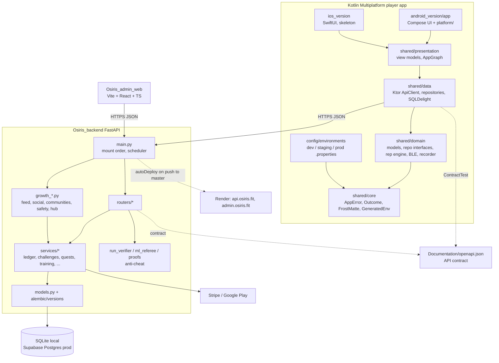

# Osiris knowledge graph for AI agents

**Mission.** Make Osiris the best fitness and fitness-competition app there is. That means verified effort,
fair competition, a loop people return to every day, and a product that never loses a player's data or crystals.

**Read this first, every session.** It tells you where everything lives, so you don't have to re-explore the repo.
Read order:
1. This file.
2. [`CLAUDE.md`](../../CLAUDE.md): commands, conventions, and the Definition of Done.
3. The area doc for the node you are touching (links in §3).

Change the code, not this file, unless the map itself moved. When you add or move a node (a router, service,
screen or table), update its row here in the same commit.

---

## 1. The graph

Dependencies only point down. `shared/` never imports Android, iOS or UI code. Platform code lives only in
`android_version/` and `ios_version/`.

---

## 2. Nodes: where each thing lives

### Backend (`Osiris_backend/`)
| Node | Path | Owns |
|---|---|---|
| App assembly | `main.py` | middleware, scheduler, router mounting (**order matters**) |
| Core | `core/` | `security.py` (JWT, RBAC), `rate_limit.py`, `origin_guard.py`, `clock.py`, `errors.py`, `logging_setup.py` |
| Settings | `settings.py` | env config; read secrets with `settings.secret("NAME")`; new settings go in `.env.example` |
| Schemas | `schemas.py` | every Pydantic request/response model |
| Models | `models.py`, `database.py` | SQLAlchemy tables |
| Migrations | `alembic/versions/` | the only way to change the schema (prod boot runs `alembic upgrade head`) |
| Tests | `tests/test_*.py` | standalone scripts, no pytest; each prints `PASS <name>` |
| Ops scripts | `scripts/` | `reconcile_ledger.py`, `check_openapi_drift.py`, `seed_admin.py`, `seed_city.py`, `load_test.py` |

| Router (`routers/`) | Area | Service(s) it uses |
|---|---|---|
| `accounts.py` | v1 sign-up, login (`/api/v1/auth/login`, needs `device_timestamp`), profile, GDPR | `services/accounts.py` |
| `runs.py` | v2 verified runs: create, start, points, finish | `run_verifier.py`, `spatial_utils.py` |
| `challenges.py` | courses, challenges, attempts, progression | `services/challenges.py`, `challenge_store.py`, `progression.py` |
| `arise.py` | Arise tab: domains, claims, Exceed workouts, attacks | `services/arise.py` |
| `training.py` | Start tab: training sessions, summary, progress, quotes, connections | `services/training.py` |
| `group_challenges.py` | Start tab group challenges (+ admin official ones) | `services/training.py` (`group_progress`, `connection_ids`) |
| `payments.py` | Stripe intents/webhooks, crystal top-ups | `stripe_gateway.py`, `ledger.py`, `google_play.py` |
| `bounties.py`, `merchants.py`, `legacy_game.py` | legacy v1 game, merchants, coupons | `ledger.py`, `proofs.py` |
| `admin_trust.py` | admin review queue, moderation, suspensions, audit | `audit.py`, `player_safety.py` |
| `system.py` | `/healthz`, `/metrics` | `metrics.py` |
| `exercise_api.py` (root) | camera-verified exercise sets | `services/exercises.py`, `ml_referee.py` |

| Growth module (root) | Area |
|---|---|
| `growth_api.py` | APIRouter for G1 core loop: daily quest, weekly goal, streaks (`services/quests.py`); `delete_growth_data` |
| `growth_feed.py` | Home feed, posts, reactions, comments, notifications, suggested challenges and Osirians |
| `growth_social.py` | sharing, invite-a-friend, referrals, public pages |
| `growth_communities.py` | communities, team goals, local rankings, city seasons (`leaderboards.py`) |
| `growth_hub.py` | Discover and Social hubs, global leaderboards |
| `growth_safety.py` | consent, blocking, reporting, data export |
| `growth_support.py` | support chat WebSocket (stub) |

### Player app, shared (`shared/<module>/src/commonMain/kotlin/com/osiris/shared/<module>/`)
| Module | Key packages / files |
|---|---|
| core | `config/` (AppConfig, GeneratedEnv), `error/` (AppError, Outcome, `outcomeOf`), `design/` (FrostMatte tokens) |
| domain | `model/` (Training.kt, Exercise.kt, ...), `repository/` (Repositories.kt, RunRepository, AriseRepository, TrainingRepository), `exercise/` (rep engine), `run/` (LocationFix), `training/` (BleParsers, TrainingRecorder), `wallet/` |
| data | `network/ApiClient` + `network/api/` (AuthApi, RunApi, ChallengeApi, MeApi, CommunityApi, ExerciseApi, AriseApi, TrainingApi), `repository/*Impl`, `storage/` (SQLDelight, settings), `DataGraph` |
| presentation | `common/` (SharedViewModel, Loadable), `navigation/` (AppNavigatorViewModel, Destinations, Tab), one package per screen: today, discover, arise, start, social, profile, run, exercise, challenge, community, session, settings, support, wallet, permission. `AppGraph` is the composition root |

### Player app, Android (`android_version/app/src/main/kotlin/com/osiris/player/`)
| Path | What |
|---|---|
| `ui/navigation/OsirisRoot.kt` | tabs (**Home · Arise · Start · Social · Profile**), routes, deep links. Wallet is a pushed route |
| `ui/navigation/StartGraph.kt` | Start tab routes: `start`, `training/{mode}`, `live/{mode}/{activity}`, `groups`, `group/{id}` |
| `ui/<feature>/` | one folder per screen, matching the presentation packages (`start/`, `training/`, `arise/`, `today/`, ...) |
| `ui/design/Frost.kt`, `ui/common/` | design system: FrostCard, KeyButton, RaisedButton, HeroMetric, OsirisScaffold, LoadableContent, EmptyState, ConfirmDialog |
| `platform/` | `location/` (fused GPS + run foreground service), `pose/` (CameraX + ML Kit), `ble/` (BLE sensors), `health/` (Health Connect), `billing/` (Play), `share/`, `speech/`, `permission/` |

### Other nodes
| Node | Path |
|---|---|
| iOS app | `ios_version/` (SwiftUI skeleton, `Observed<VM,State>`; see `ios_version/README.md`) |
| Admin console | `Osiris_admin_web/src/`: `api/client.ts` + `api/types.ts`, `pages/*Page.tsx` (Dashboard, Trust, Growth, Community, Bounties, Merchants, ExerciseReview, OfficialChallenges), `components/Sidebar.tsx` |
| API contract | `Documentation/openapi.json` (CI checks drift) |
| Product and architecture docs | `Documentation/Enterprise/01..20_*.md` (PRD, domain/economy, ADRs, release status, audits); `docs/architecture/` (app + backend); `docs/deployment/production.md` |
| Feature specs and plans | `docs/superpowers/specs/`, `docs/superpowers/plans/` (Arise, Start screen) |
| Work queue | `PLAN.md` (`- [ ]` items; `[human]` items need the owner) |
| Deploy | `render.yaml` (Blueprint, `autoDeploy: true`), `Osiris_backend/Dockerfile` (boot = `alembic upgrade head && uvicorn`), `supabase/`, `infrastructure/` (backups, docker) |
| CI and gate | `.github/workflows/ci.yml`, `.claude/hooks/gate.sh` |

---

## 3. Feature slices: everything one feature touches

Follow a row left to right to change a feature end-to-end.

| Feature | Backend | Shared (domain → data → presentation) | Android UI | Tests | Docs |
|---|---|---|---|---|---|
| Auth / account | `routers/accounts.py`, `core/security.py` | `AuthRepository` → `AuthApi`, `SessionStore` → `session/` | `ui/session/` | `test_phase2_security`, `test_mvp_gdpr_and_email_uniqueness` | Enterprise/05 |
| Verified runs (GPS) | `routers/runs.py`, `run_verifier.py`, `spatial_utils.py` | `RunRepository` → `RunApi`, `RunRepositoryImpl` (offline queue) → `run/` | `ui/run/`, `platform/location/` | `test_run_release`, `test_replay_guard` | Enterprise/10 |
| Courses and challenges | `routers/challenges.py`, `services/challenges.py`, `challenge_store.py` | `ChallengeRepository` → `ChallengeApi` → `challenge/` | `ui/challenge/`, `ui/map/` | `test_challenge_release` | Enterprise/03 |
| Camera exercises (pose) | `exercise_api.py`, `services/exercises.py`, `ml_referee.py` | `domain/exercise/` rep engine, `data/exercise/` SQLDelight sync → `exercise/` | `ui/exercise/`, `platform/pose/` | `test_exercise_sessions`, `test_ml_referee`, `shared/testdata/` recordings | Enterprise/13, 15, 16 |
| Arise (territory) | `routers/arise.py`, `services/arise.py` | `AriseRepository` → `AriseApi` → `arise/` | `ui/arise/` | `test_arise` | specs/2026-11-01-arise-design.md |
| Start: Train / Challenge / live sessions | `routers/training.py`, `services/training.py` | `model/Training.kt`, `training/BleParsers`, `TrainingRecorder` → `TrainingApi`, `TrainingRepositoryImpl` → `start/` | `ui/start/`, `ui/training/LiveSessionScreen.kt`, `platform/ble/`, `platform/health/` | `test_training`, `BleParsersTest`, `TrainingRecorderTest`, `StartViewModelTest` | specs/2026-11-02-start-screen-design.md |
| Group challenges | `routers/group_challenges.py` | `GroupChallengeRepository` → `start/GroupChallengeViewModels.kt` | `ui/training/GroupChallengeScreens.kt`; admin `OfficialChallengesPage.tsx` | `test_training` | same spec |
| Progress (history) | `routers/training.py` `/me/training/progress` | `ProgressViewModel` | `ui/profile/ProgressSection.kt` | `StartViewModelTest` | same spec |
| Quests, streaks, XP, rank | `growth_api.py`, `services/quests.py`, `progression.py` | `PlayerRepository` → `MeApi` → `today/`, `profile/` | `ui/today/`, `ui/profile/` | `test_growth_core_loop`, `test_party_stats` | Enterprise/11 |
| Home feed, notifications | `growth_feed.py` | `CommunityRepository` → `today/` | `ui/today/TodayFeedComponents.kt` | `test_home_social_feed` | PLAN.md §1-2 |
| Social, sharing, referrals | `growth_social.py`, `growth_hub.py` | `CommunityApi` → `social/`, `discover/` | `ui/social/`, `ui/discover/` | `test_growth_sharing`, `test_growth_hub` | Enterprise/11 |
| Communities, rankings, seasons | `growth_communities.py`, `services/leaderboards.py` | `community/` | `ui/community/` | `test_growth_communities` | Enterprise/11 |
| Safety, privacy, GDPR | `growth_safety.py`, `services/player_safety.py`, `audit.py` | `PrivacyRepository` → `settings/` | `ui/settings/` | `test_growth_safety` | Enterprise/05 |
| Crystals, payments | `services/ledger.py` (**sole writer** of `User.mana_crystals`), `routers/payments.py`, `stripe_gateway.py`, `google_play.py` | `wallet/` (MockWalletRepository in dev/staging) | `ui/wallet/` | `test_phase2_ledger`, `test_phase3_stripe`, `test_google_play_billing` | docs/architecture/google-play-billing.md |
| Admin trust and moderation | `routers/admin_trust.py` | n/a | admin `TrustPage.tsx`, `ExerciseReviewPage.tsx` | `test_v2_10_flows` | Enterprise/05 |
| Ops: rate limits, origin lock, metrics | `core/rate_limit.py`, `core/origin_guard.py`, `services/metrics.py` | n/a | n/a | `test_rate_limits`, `test_origin_guard`, `test_settings`, `test_public_base_url` | docs/deployment/production.md, Enterprise/08 |

---

## 4. Recipes: how to do a common task

- **Add an endpoint.**
  1. Router in `routers/` (or the matching `growth_*.py`).
  2. Pydantic models in `schemas.py`.
  3. Rules in `services/`.
  4. Test in `tests/test_<area>.py`.
  5. Run `python scripts/check_openapi_drift.py --write`.
  6. On the client: a method in `shared/data/.../network/api/<Area>Api.kt` plus a `ContractTest` entry.
- **Change the schema.**
  1. `models.py`, then a new file in `alembic/versions/` (revises the current head).
  2. Check: `alembic upgrade head` from an empty DB, then `alembic check`.
  3. Add the table to the GDPR export and erasure (`growth_safety.py` export, `growth_api.delete_growth_data`).
- **Add a backend test suite.** Copy an existing `tests/test_*.py`, then add it to `ci.yml` and to `BACKEND_TESTS` in `.claude/hooks/gate.sh`.
- **Add a screen.**
  1. Model and interface in `shared/domain`.
  2. Api and RepositoryImpl in `shared/data`, wired in `DataGraph`.
  3. View model in `shared/presentation/<feature>/`, plus a factory in `AppGraph`.
  4. Compose screen in `android_version/.../ui/<feature>/`, using `rememberShared { graph.x() }`.
  5. Add a route in `OsirisRoot.kt` or the tab's graph.
  6. Add a jvmTest for the view model.
- **Add an admin page.** Add `pages/XxxPage.tsx`, the types in `api/types.ts`, calls in `api/client.ts`, then register it in `Sidebar.tsx` and `App.tsx`.
- **Run it locally.**
  - API: `cd Osiris_backend && OSIRIS_JWT_SECRET=<any> OSIRIS_ENV=dev ../.venv/Scripts/uvicorn.exe main:app --host 0.0.0.0 --port 8000`.
  - Emulator: `$LOCALAPPDATA/Android/Sdk/emulator/emulator.exe -avd test_device -memory 2048`.
  - App: build with `JAVA_HOME="/c/Program Files/Android/Android Studio/jbr"`, run `./gradlew :android_version:app:assembleDebug`, then `adb install -r` and `adb reverse tcp:8000 tcp:8000`.
  - Demo players: `start.demo@example.com` and `start.friend@example.com`, password `StartDemo1!` (local DB only).

---

## 5. Invariants: never break these

1. Every crystal movement goes through `services.ledger.apply_crystal_delta`. It does not commit; the endpoint does. **Challenges never touch crystals.**
2. Verification happens on the server (`run_verifier`, `ml_referee`, `proofs`, and the training plausibility checks). Never trust client-reported totals.
3. Schema changes go through Alembic only. Prod is Supabase Postgres: RLS is on, `anon` and `authenticated` are revoked, and only the app role connects.
4. Never commit secrets. In particular:
   - `config/environments/local.properties` holds the Mapbox token.
   - `.env`, `keystore.properties` and MCP tokens stay out of git.
   - Read secrets with `settings.secret()`.
5. API changes regenerate `Documentation/openapi.json`.
6. No `TODO`, `FIXME`, `print` or `console.log` in changed code. Use conventional commits.
7. Server datetimes are naive UTC. The KMP side parses them with `ServerInstantSerializer`.

## 6. Gotchas: things that already cost a session

- **The gate is diff-scoped.** `gate.sh` fingerprints `git diff HEAD`, so once work is committed it runs **nothing** and exits 0. Before merging, run the checks branch-wide:
  - strict ruff on the changed files, then ruff;
  - alembic from zero (use a Windows path via `cygpath -m`) plus `alembic check`;
  - every suite in `ci.yml`, and the OpenAPI drift check;
  - `npm run build`;
  - `./gradlew detekt`, the jvmTests, the iOS compile, and `assembleDebug`.
- **The worktree is shared.** Several agents (Claude sessions, Antigravity, and others) edit `C:\Folder D\Project_PA` at once.
  - Work in `git worktree add ../Project_PA-<slug> -b <branch> master`.
  - Stage explicit paths only; never `git add .` or `git stash`.
  - Push with `git push origin HEAD:master`.
- **A push to master deploys production.** Render `autoDeploy: true` rebuilds `osiris-api`, and boot runs the migrations on Supabase. Keep migrations additive and Postgres-safe.
- **Windows.**
  - Git-bash `/tmp` is not visible to the Windows Python.
  - `JAVA_HOME` is not set; use the Android Studio `jbr`.
  - Heredocs that contain apostrophes break; write the file instead.
- **Restarting the local API with a new `OSIRIS_JWT_SECRET` signs the app out.**
- **Memory is tight.** Claude Code may kill background processes (the emulator, uvicorn) under memory pressure. Restart only when asked.
- **Detekt** ignores MagicNumber in `@Composable` functions. Max line length is 140, CyclomaticComplexMethod is 15, ReturnCount is 2. `-Werror` is on.
- **Guava.** Health Connect pulls in Guava only at runtime, which breaks CameraX's `ListenableFuture` at compile time. `guava:31.1-android` is a compile dependency on purpose.

---

## 7. Environments
| Env | API | Admin | DB |
|---|---|---|---|
| local | `http://localhost:8000` (emulator via `adb reverse` or `10.0.2.2`) | `npm run dev` in `Osiris_admin_web` (:5173) | `Osiris_backend/fitness_mvp.db` (SQLite) |
| prod | `https://api.osiris.fit` (Render `osiris-api`, srv-dbfaet5g1s2s73f2de2g) | `https://admin.osiris.fit` (Render static) | Supabase project `vhymfishiojgttlzcdgf`, via the session pooler |

App builds choose an env with `-Posiris.env=dev|staging|prod` (`config/environments/`).

---

## 8. Agent toolbox

The goal of every session: ship verified, tested improvements that make Osiris the best fitness-competition app.

### Permissions
`.claude/settings.json` (committed) allows every built-in tool, plus the MCP servers below, without prompts.
The PreToolUse guard (`.claude/hooks/guard.sh`) is a no-op. Judgment still applies:
- A push to master is a production deploy.
- Production DB writes (Supabase MCP `execute_sql`, `apply_migration`) and Render env or deploy changes affect real players. Say what you will change before you do it.

### MCP servers (`.mcp.json`)
| Server | Use it for | Setup |
|---|---|---|
| `supabase` | prod Postgres: inspect tables, logs, advisors (project `vhymfishiojgttlzcdgf`) | OAuth on first use |
| `render` | prod services, deploys, logs, env vars | set the `RENDER_API_KEY` env var (Render dashboard > Account > API keys) |
| `playwright` | drive the admin console or public pages in a browser | none (npx) |
| `rea` | reverse-engineering and inspecting APKs, ADB devices, emulator screens, logcat | none (npx) |

Claude-account connectors (claude.ai Docs, Google Drive, Artifacts, Claude in Chrome) come from the signed-in Claude account, not the repo.

### Claude Code plugins (`enabledPlugins` in `.claude/settings.json`)
| Plugin | Gives you |
|---|---|
| `superpowers` | brainstorming, writing and executing plans, TDD, systematic debugging, verification, finishing a branch |
| `ecc` | language reviewers (kotlin, python, fastapi, react), build resolvers, security review, e2e, many domain skills |
| `ponytail` | smallest-complete-change discipline |
| `plugin-dev` | building plugins, hooks, skills |

### Project agents and skills
- Subagents (`.claude/agents/`):
  - `planner`: goal → PLAN.md items.
  - `implementer`: one PLAN.md item end-to-end.
  - `reviewer`: diff vs acceptance criteria.
  - `test-writer`: tests that follow the house patterns.
- Skills (`.claude/skills/`): design, design-system, brand, banner-design, slides, ui-styling, ui-ux-pro-max. The same skills are mirrored for other agents in `.agents/`, `.cursor/`, `.windsurf/`, `.gemini/`, `.augment/`, `.roo/`, `.trae/`, `.continue/`, `.kiro/`.

### Other agents (Codex, Gemini / Antigravity, Cursor, Windsurf, ...)
1. Read `AGENTS.md`, then this file.
2. Register the same MCP servers in your tool's own config, using `.mcp.json` as the source of truth.
3. Never paste tokens into tracked files.
